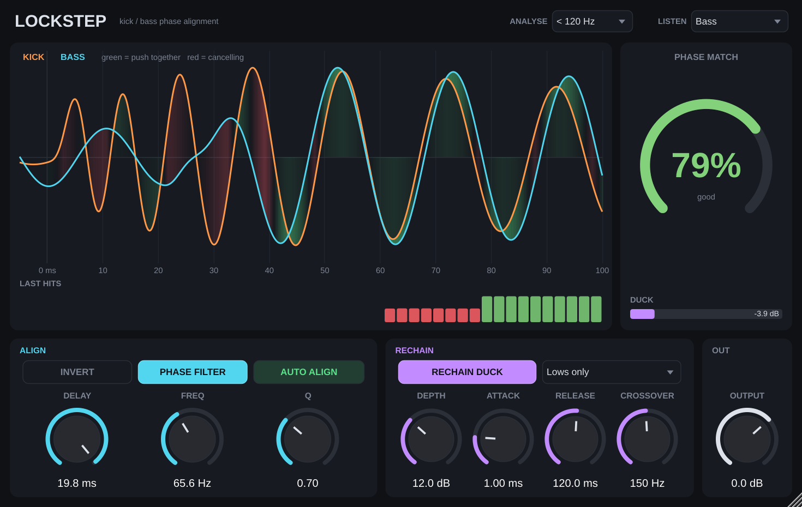

# Lockstep — kick / bass phase alignment

An original ReVision-2-style tool (VST3 / AU / Standalone, macOS + Windows), built with JUCE 8.
Put it on the **bass**, send the **kick** to its sidechain, and see — and fix — whether they push together or cancel.



## Setup in Ableton
1. Put Lockstep on the bass track.
2. In the plugin's device header open the **Sidechain** section (the triangle / "Sidechain" toggle), turn it on and choose the kick track as Audio From.
3. Press play. Every kick hit is captured and drawn over the bass.

## What you see
- **Waveform**: low end (< 120 Hz by default) of the kick (orange) and bass (cyan) for the last kick hit, 0–100 ms.
  Green shading = they reinforce each other, red = they cancel.
- **Phase Match**: correlation of kick and bass in that window. 50 % = unrelated, 100 % = perfectly in phase, 0 % = fully cancelling.
- **Last hits**: match per hit, so you can see if it's consistent across the loop.

## Controls
| Control | What it does |
|---|---|
| **Invert** | Flips bass polarity |
| **Delay** | Delays the bass 0–20 ms (fractional, smooth) |
| **Phase Filter + Freq / Q** | 2nd-order allpass: rotates bass phase around Freq without changing its tone |
| **Auto Align** | Searches polarity, delay and phase filter over the last 6 hits and sets the best combination |
| **ReChain Duck** | Ducks the bass on every kick. Depth, Attack, Release. Follows the kick's own envelope, no threshold to set |
| **Full band / Lows only + Crossover** | Duck the whole bass, or only below the crossover (transparent when not ducking) |
| **Analyse** | Band used for the measurement: < 80 / 120 / 200 Hz |
| **Listen** | Bass, Bass + Kick (hear the cancellation), or Kick |
| **Output** | Output gain |

Zero latency. With everything off, output is bit-identical to input.

## Build — the easy way (GitHub Actions)
1. Push this folder to a GitHub repo (make sure the hidden `.github` folder is included).
2. Actions tab → latest run → Artifacts: Mac VST3 + AU, Windows VST3.
3. Install:
   - **Mac:** `Lockstep.vst3` → `~/Library/Audio/Plug-Ins/VST3/`, `Lockstep.component` → `~/Library/Audio/Plug-Ins/Components/`, then
     `xattr -cr ~/Library/Audio/Plug-Ins/VST3/Lockstep.vst3 ~/Library/Audio/Plug-Ins/Components/Lockstep.component` (unsigned build)
   - **Windows:** `Lockstep.vst3` → `C:\Program Files\Common Files\VST3\`
4. Ableton → Settings → Plug-Ins → Rescan.

## Build locally
CMake ≥ 3.22 + Xcode (Mac) or Visual Studio 2022 (Windows). JUCE downloads automatically.
```bash
cmake -B build -G Xcode                      # Mac (universal)
cmake -B build -G "Visual Studio 17 2022"    # Windows
cmake --build build --config Release
```

## Source map
- `Source/Analysis.h` — allpass, correlation, auto-align search
- `Source/PluginProcessor.*` — sidechain, delay / phase / polarity, ducking, hit capture
- `Source/HitView.*` — waveform overlay, history, match gauge
- `Source/PluginEditor.*`, `Source/LockstepLookAndFeel.h` — UI
